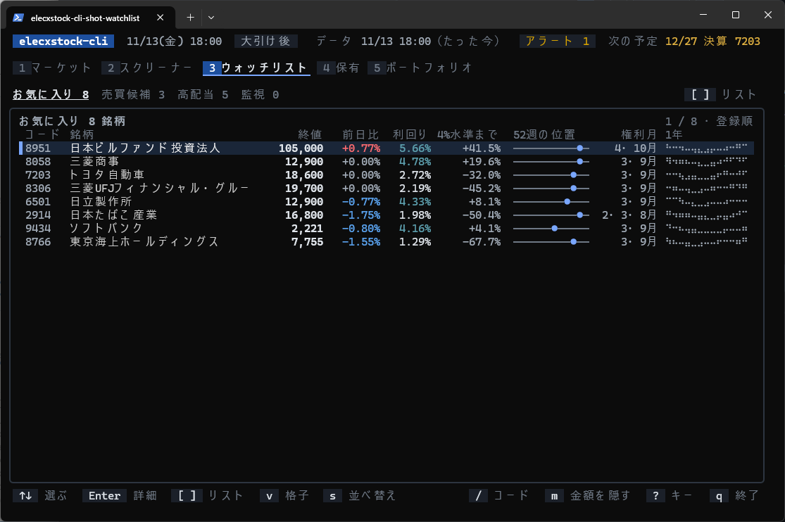
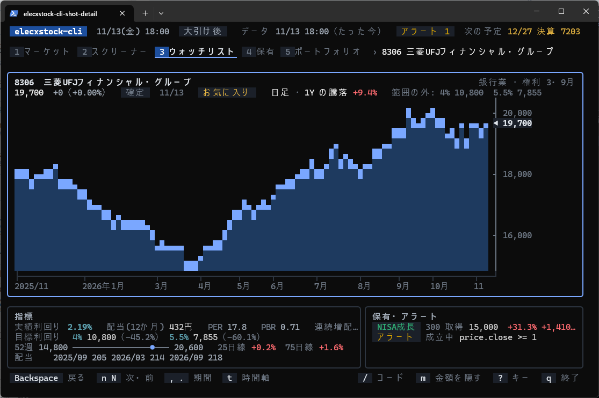
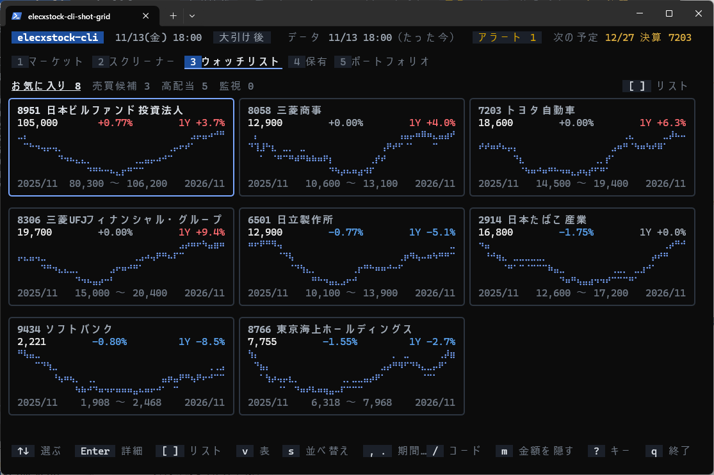
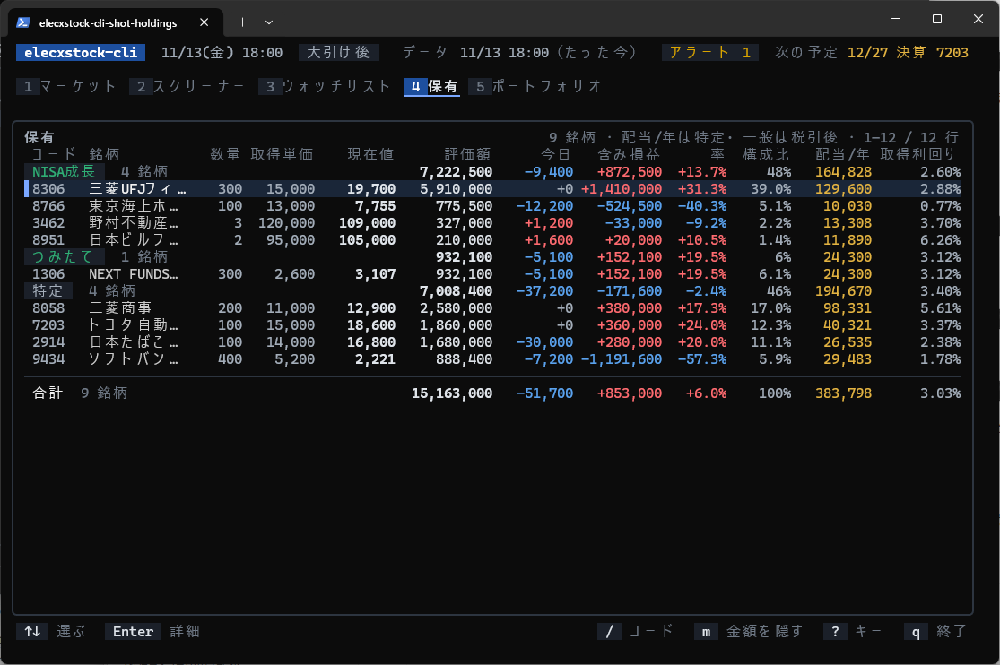
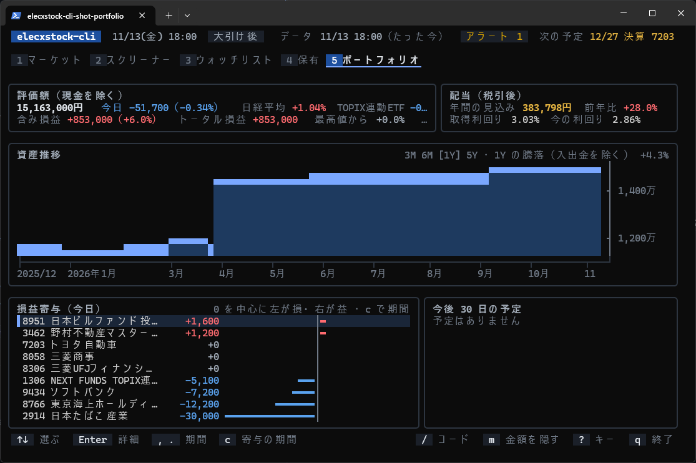
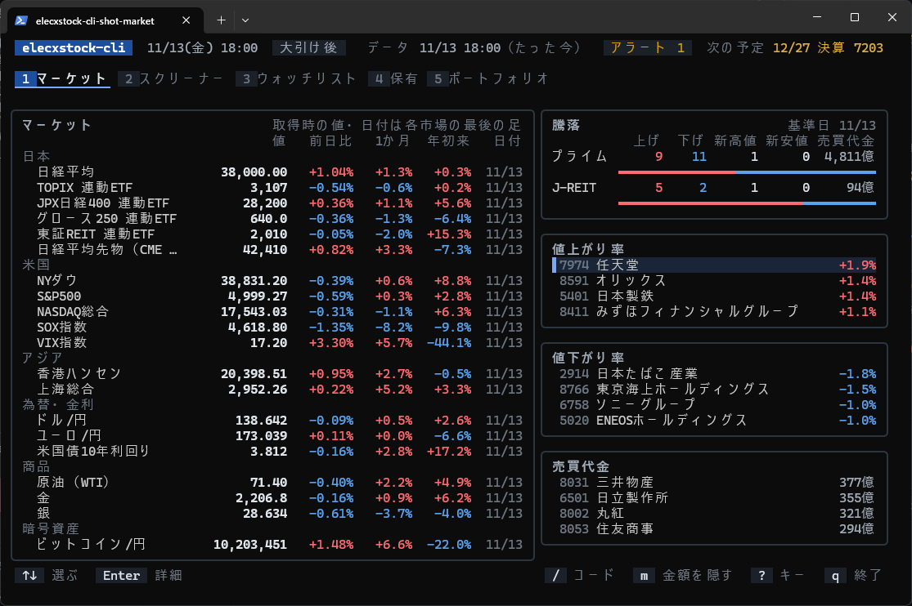

# elecxstock-cli

<p align="center">
  <a href="https://github.com/kurouna/elecxstock-cli/releases/latest"></a>
  <a href="https://github.com/kurouna/elecxstock-cli/actions/workflows/ci.yml"></a>
  <a href="https://opensource.org/licenses/MIT"></a>
  
  <a href="https://claude.com/claude-code"></a>
</p>

[日本語](#日本語) | [English](#english)

<p align="center">
  
</p>

<p align="center">値はすべて架空です（elecxstock のテスト用のスタブのデータ） / All values are fictitious (elecxstock's stub test data)</p>

---

## 日本語

[elecxstock](https://github.com/kurouna/elecxstock)（日本株と J-REIT のデスクトップアプリ）が手元の PC に貯めたデータを、
ターミナルで `top` のように眺め続けるための **読み取り専用** の CUI です。アプリを開かなくても、ターミナルの片隅で
市場・監視銘柄・保有・予定を横目で見られます。

- **画面は 5 つ**: `1` マーケット・`2` スクリーナー・`3` ウォッチリスト・`4` 保有・`5` ポートフォリオ。どの画面からも `Enter` で銘柄の**詳細**（推移のチャート・指標・目標利回り・保有・アラート）に入ります。
- **読むだけ**: データの取得（Yahoo・JPX への通信）はしません。DB は読み取り専用で開き、利用者のデータ（★・ウォッチリスト・保有・アラートなど）も書きません。値は elecxstock が取得したときのもので、リアルタイムではありません。
- **データが変わったら自動で読み直す**: 2 秒ごとに、DB と利用者のデータが変わったかだけを確かめます。アプリで更新すると、こちらの表示も追いつきます。
- **計算はアプリと同じ**: elecxstock のソース（指標・スクリーナー・保有・資産推移の計算）をそのまま使っています。

> **注意**
>
> - elecxstock を一度起動して、初回の取り込みを済ませてから使ってください。
> - 本ツールは投資助言ではありません。投資の判断はご自身の責任で行ってください。
> - 表示しているデータは elecxstock が取得したもので、その利用条件に従います（個人の利用の範囲で。再配布しないでください）。

### インストール

[Releases](https://github.com/kurouna/elecxstock-cli/releases/latest) から `elecxstock-cli.exe`（または zip）を取り、PATH の通ったフォルダに置きます。
Node.js は要りません（実行ファイルに含まれています）。

- コードに署名していないので、初回は Windows の SmartScreen が警告することがあります。
- 対応する elecxstock の版は `elecxstock-cli --version` で出ます。アプリの DB の版が違うときは、起動せずに知らせます。

### 使い方

Windows Terminal などで:

```bash
elecxstock-cli
```

| オプション              | 意味                                                                                        |
| ----------------------- | ------------------------------------------------------------------------------------------- |
| `--data <フォルダ>`     | `market.db` と `user\` のある data フォルダ（既定はアプリと同じ場所。下の「データの場所」） |
| `--where`               | 使う data フォルダ・DB の版・最終更新を出して終わる                                         |
| `--tab <1〜5>`          | はじめの画面（既定は 3 ウォッチリスト）                                                     |
| `--theme <dark\|light>` | 端末の地が明るいときは `light`                                                              |
| `--no-color`            | 色を使わない（`NO_COLOR` でも同じ）                                                         |

幅 80 桁 × 24 行から動きます（狭いときは列を減らします）。120 桁 × 40 行くらいが見やすい大きさです。

### キー

| キー                   | 操作                                                             |
| ---------------------- | ---------------------------------------------------------------- |
| `1`〜`5`・`Tab`        | 画面を切り替える（全角の数字でも）                               |
| `↑` `↓`・`PgUp` `PgDn` | 行を選ぶ                                                         |
| `Enter`                | 選んだ銘柄の詳細                                                 |
| `Backspace`・`Esc`     | 詳細から戻る（元の画面の同じ行に戻る）                           |
| `n` `N`                | 詳細で、元の一覧の次・前の銘柄                                   |
| `,` `.`                | 期間（3M・6M・1Y・5Y）                                           |
| `t`                    | 詳細の時間軸（日足・週足・月足）                                 |
| `[` `]`                | ウォッチリスト・保存したスクリーンを切り替える                   |
| `v`                    | ウォッチリスト・スクリーナーを格子（小さなチャートの並び）にする |
| `s`                    | 並べ替え（選んだ銘柄はそのまま）                                 |
| `c`                    | ポートフォリオの損益寄与の期間（今日・今月・今年）               |
| `/`                    | コードを打って詳細を開く                                         |
| `m`                    | 金額を隠す（画面を見せるとき）                                   |
| `r`                    | 読み直す                                                         |
| `?`                    | キーの一覧                                                       |
| `q`・`Ctrl+C`          | 終わる                                                           |

### データの場所

アプリと同じ決め方で探します。

1. `--data <フォルダ>`
2. 環境変数 `ELECXSTOCK_USER_DATA` があれば `<それ>\data`
3. Windows: `%APPDATA%\elecxstock\data`（macOS: `~/Library/Application Support/elecxstock/data`、Linux: `~/.config/elecxstock/data`）

`elecxstock-cli --where` で、どこを読んでいるかを確かめられます。

### 画面の例

Windows Terminal で動かして撮ったものです（値はすべて架空。elecxstock のテスト用のスタブのデータ）。

| 詳細（Enter）                                            | 格子（v）                                                       |
| -------------------------------------------------------- | --------------------------------------------------------------- |
|        |                 |
| **4 保有**                                               | **5 ポートフォリオ**                                            |
|      |  |
| **1 マーケット**                                         |                                                                 |
|  |                                                                 |

### 開発

```bash
git clone --recurse-submodules https://github.com/kurouna/elecxstock-cli
cd elecxstock-cli
npm ci
npm run fixture                              # 架空のデータを .fixture/data に作る
npm run dev -- --data .fixture/data          # 動かす
npm run verify                               # lint・型検査・テスト（キー操作の E2E を含む）
npm run sea                                  # 単一実行ファイル dist/elecxstock-cli.exe
npm run shots                                # README のスクリーンショット（Windows Terminal で架空のデータを撮る）
```

- Node.js 25.5 以降（`node --build-sea` と `node:sqlite` を使います）。
- elecxstock のソースは git のサブモジュール（`vendor/elecxstock`）で、リリースのタグに固定しています。
- 設計: [docs/design.md](docs/design.md)。
- `v*` のタグを付けてプッシュすると、GitHub Actions がテストを通したうえで exe を Releases に公開します。

### ライセンス

[MIT](LICENSE)。配布物に同梱した OSS のライセンスは、zip の `THIRD_PARTY_NOTICES.txt` にあります。

---

## English

A **read-only**, `top`-like terminal UI for the data that [elecxstock](https://github.com/kurouna/elecxstock)
(a desktop app for Japanese stocks and J-REITs) keeps on your PC. Keep an eye on the market, your watchlists,
holdings and upcoming events in a corner of your terminal without opening the app.

- **Five screens**: `1` Market, `2` Screener, `3` Watchlist, `4` Holdings, `5` Portfolio. Press `Enter` on any row to open the **detail** view (price chart, metrics, target yields, holdings and alerts).
- **Read-only**: it never fetches data (no network) and never writes. The database is opened read-only and your user data (stars, watchlists, holdings, alerts) is left untouched. Values are as of the app's last update, not real-time.
- **Follows the app**: every 2 seconds it checks whether the database or the user data changed and reloads only then.
- **Same numbers as the app**: it reuses elecxstock's own source for metrics, screening, holdings and portfolio history.

> **Notes**
>
> - Run elecxstock once and finish the initial import first.
> - This is not investment advice.
> - The data was fetched by elecxstock and is subject to its terms (personal use only, do not redistribute).

### Install

Download `elecxstock-cli.exe` (or the zip) from [Releases](https://github.com/kurouna/elecxstock-cli/releases/latest) and put it on your PATH.
No Node.js installation is needed. The binary is not code-signed, so Windows SmartScreen may warn on first run.

### Usage

```bash
elecxstock-cli
```

Options: `--data <folder>` (the app's `data` folder), `--where` (print the folder and database version), `--tab <1-5>`,
`--theme <dark|light>`, `--no-color`, `--version`, `--help`. Works from 80 × 24; about 120 × 40 looks best.

Keys: `1`–`5`/`Tab` screens, `↑↓`/`PgUp`/`PgDn` select, `Enter` detail, `Backspace`/`Esc` back, `n`/`N` next/previous,
`,`/`.` period, `t` timeframe, `[`/`]` lists and screens, `v` grid, `s` sort, `c` contribution period, `/` open by code,
`m` hide amounts, `r` reload, `?` help, `q` quit. The UI is in Japanese.

Data folder lookup: `--data`, then `%ELECXSTOCK_USER_DATA%\data`, then `%APPDATA%\elecxstock\data`
(macOS `~/Library/Application Support/elecxstock/data`, Linux `~/.config/elecxstock/data`).

### Development

Node.js 25.5+. Clone with `--recurse-submodules` (elecxstock's source is a submodule pinned to a release tag), then
`npm ci`, `npm run fixture` (fictitious data), `npm run dev -- --data .fixture/data`, `npm run verify`, `npm run sea`.
Pushing a `v*` tag builds, tests and publishes the exe to GitHub Releases.

### License

[MIT](LICENSE). Licenses of bundled open-source software are in `THIRD_PARTY_NOTICES.txt` in the zip.
